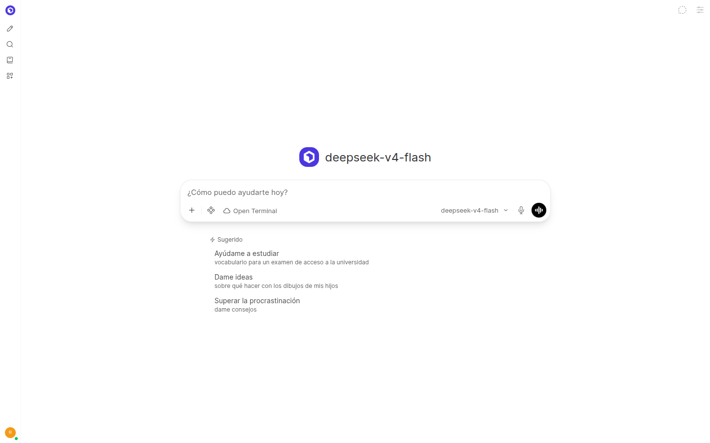
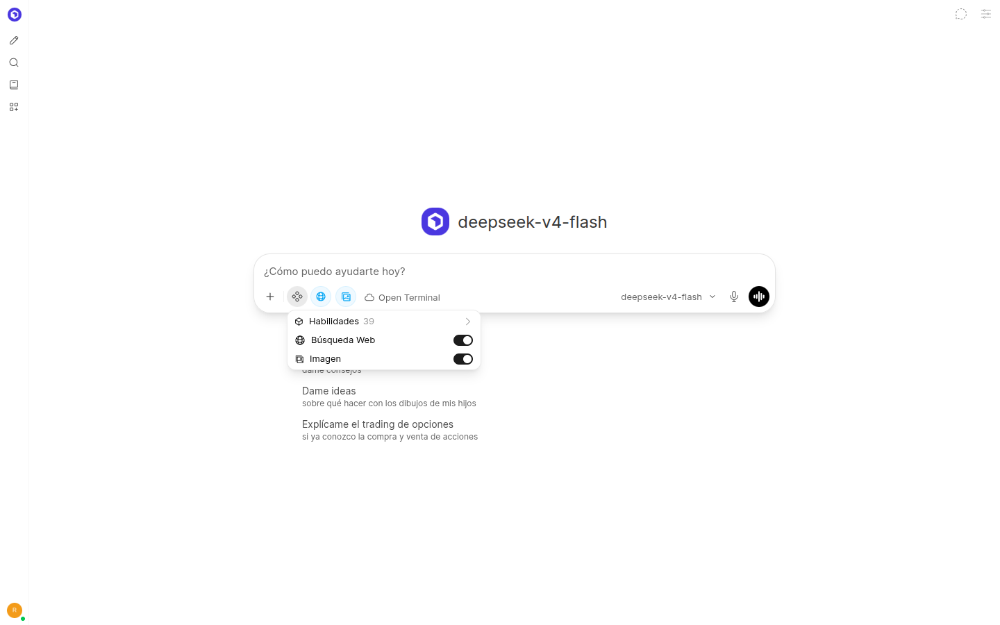
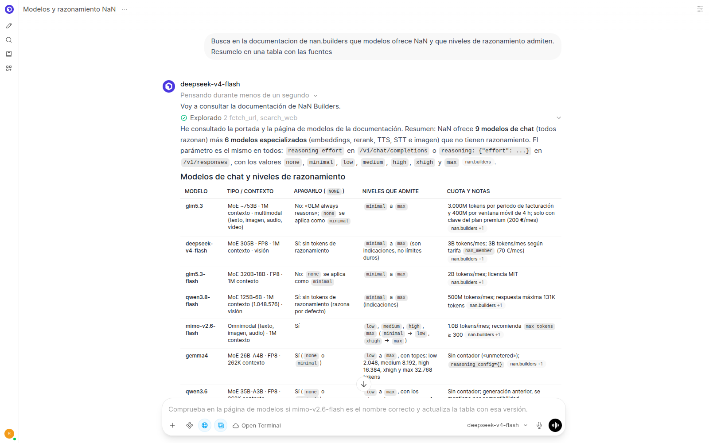
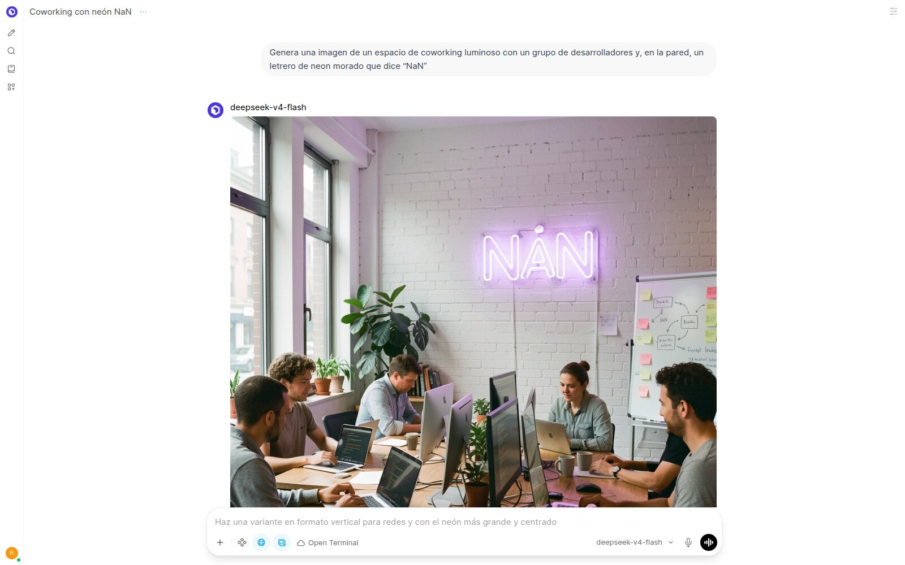
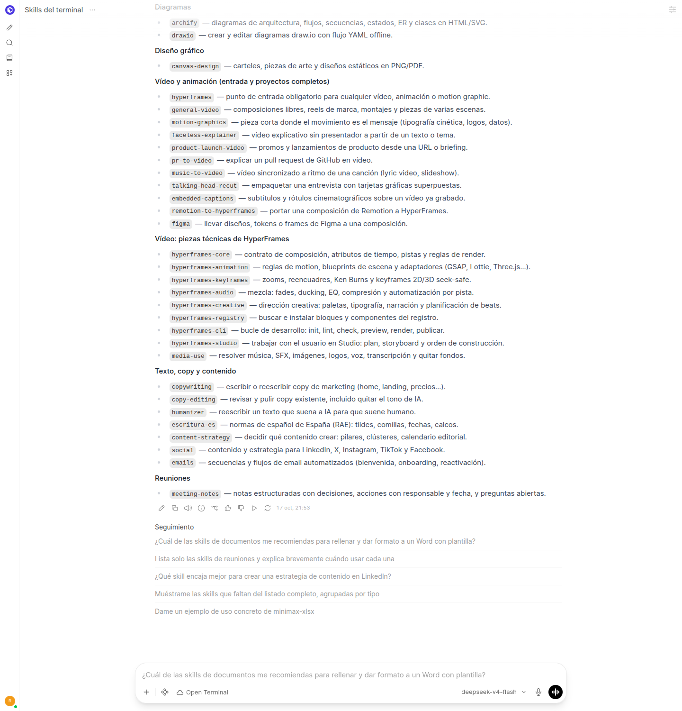
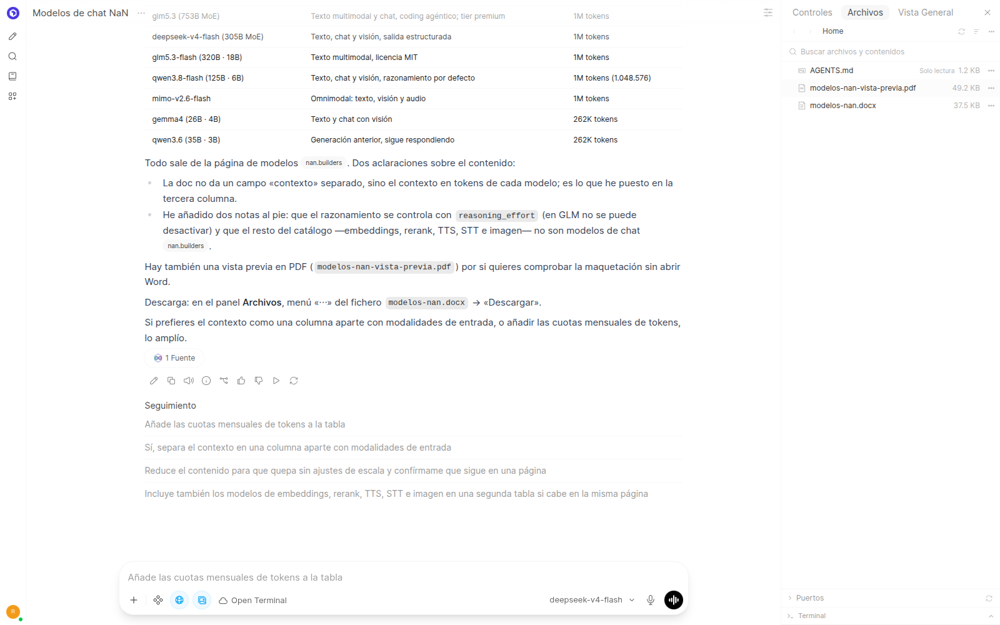

# Manual de uso

Cómo sacar partido a NaN Chat una vez instalado. Para instalarlo, mira la
[guía paso a paso](GUIA-PASO-A-PASO.md) o la [puesta en marcha del README](README.md#puesta-en-marcha).

## 1. Entrar

Abre `http://localhost:3000` (o la dirección de tu servidor) y pulsa *Empezar*. La
primera cuenta que se crea es la de administrador: créala nada más instalar. Después
nadie puede registrarse por su cuenta; el administrador da de alta a cada persona en
*Administración > Usuarios*, botón «+».

## 2. Elegir modelo

El selector de arriba muestra los modelos de chat de NaN. Para empezar:

| Si quieres... | Usa |
| --- | --- |
| Uso general, documentos, webs, vídeo y encargos largos con el terminal | `deepseek-v4-flash` (el de serie) |
| Analizar imágenes que adjuntas | `qwen3.8-flash` o `mimo-v2.6-flash` |
| Respuestas rápidas y cortas | `gemma4` |

Todos razonan antes de responder. Para que respondan más rápido en preguntas
sencillas: *Controles del chat > Parámetros avanzados > Reasoning Effort* y elige
`low` o `none`.

## 3. Buscar en internet

Viene activada: el botón *Integraciones* (el de los cuatro puntos, junto al `+`) muestra
*Búsqueda Web* encendida. Si la pregunta necesita datos actuales, el modelo busca solo
(con SearXNG, que consulta a la vez Bing, Google, Yahoo, Yep y DuckDuckGo), abre las páginas y cita las fuentes.
Para forzarlo, pídelo: «Busca en la documentación de nan.builders qué modelos ofrece
NaN y qué niveles de razonamiento admiten. Resúmelo en una tabla con las fuentes».

## 4. Imágenes

**Generar una imagen:**

1. Comprueba que *Imagen* está encendida en *Integraciones* (viene así de serie).
2. Pide la imagen describiendo lo que quieres, por ejemplo: «Genera una imagen de un
   cartel minimalista con el texto "NaN" en grandes letras blancas sobre fondo morado
   oscuro, estilo comunidad de desarrolladores».
3. El modelo redacta un prompt más detallado y llama a `qwen-image-2.1`. Tarda
   alrededor de un minuto y la imagen aparece en el chat, con un botón para descargarla.

Consejos:

- **Texto dentro de la imagen:** ponlo entre comillas; `qwen-image-2.1` lo escribe bien.
- **Tamaño:** sale cuadrada (1024 × 1024); el tamaño lo fija el administrador con
  `IMAGE_SIZE`.
- **Pedir otra versión:** sigue en el mismo chat («más oscura», «sin texto»...).

**Editar una imagen:** adjúntala con el `+` y pide el cambio («quita el fondo», «pon el
texto en blanco»). Usa `flux-2-klein` y tarda unos segundos.

## 5. Tus documentos

- **En un chat:** adjunta PDF, Word, Excel o texto con el botón `+` y pregunta sobre
  ellos.
- **Para tenerlos siempre a mano:** *Espacio de trabajo > Conocimiento*, crea una
  colección y sube los documentos. En el chat, escribe `#` y elige la colección.

## 6. Voz

El micrófono de la caja de texto dicta; el icono de ondas abre el modo de voz, que
responde hablando (voz `ef_dora` de NaN).

## 7. El terminal y las skills

El chat trae un **terminal** (Open Terminal) ya seleccionado: el botón con forma de nube
de la caja de texto muestra «Open Terminal». Con él, el modelo puede crear ficheros de
verdad: Word, PowerPoint, Excel, PDF, webs, diagramas, vídeos...

No hay que instalar ni activar nada. El modelo tiene una lista de **skills**
(instrucciones expertas para cada tipo de encargo) y carga la que necesita. Basta con
pedirlo en lenguaje normal:

| Para conseguir... | Pide algo como |
| --- | --- |
| Un informe en Word | «Lee https://nan.builders/docs/models y hazme un Word de una página que resuma los modelos de chat de NaN en una tabla» |
| Una presentación PowerPoint | «Hazme una presentación de 6 diapositivas que explique qué es NaN y cómo empezar, a partir de nan.builders/docs» |
| Una presentación web animada | «Hazme una presentación en HTML para una charla de 10 minutos sobre la comunidad NaN» |
| Un Excel con fórmulas | «Hazme un Excel para controlar el consumo mensual de tokens de NaN por modelo, con totales y gráfica» |
| Un PDF con diseño | «Hazme una guía rápida en PDF de una página para empezar con NaN Chat» |
| Una web | «Crea una landing para presentar NaN Chat a mi equipo» |
| Un cartel o pieza gráfica | «Diseña un cartel vertical en PNG para un encuentro de la comunidad NaN» |
| Un vídeo | «Crea un vídeo de 15 segundos, horizontal y sin voz, que presente NaN Chat» |
| Un diagrama | «Haz un diagrama de arquitectura de NaN Chat: Open WebUI, la API de NaN, SearXNG y Open Terminal en Docker» |
| Un organigrama | «Hazme en draw.io el organigrama del equipo que va a usar NaN Chat» |
| Textos comerciales | «Escribe el texto de una página que invite a unirse a la comunidad NaN» |
| Corregir un texto | «Corrige y mejora este texto sin cambiar los datos: ...» |
| Publicaciones para redes | «Escribe 3 publicaciones para LinkedIn sobre por qué usamos NaN en el equipo» |
| Correos | «Escribe una secuencia de 3 correos de bienvenida para los nuevos usuarios de NaN Chat» |
| Un plan de contenidos | «Hazme un plan de contenidos de un mes para dar a conocer NaN en la empresa» |
| Un acta | «Haz el acta de esta reunión sobre la adopción de NaN: ...» (pega tus notas) |
| Analizar datos | Sube un CSV o Excel (por ejemplo, el consumo de NaN) y pide «analízalo y hazme las gráficas» |

Consejos:

- **Da los datos que tengas.** Lo que no le des lo marcará como «(ejemplo)» o entre
  corchetes para que lo sustituyas; revisa siempre esas marcas antes de usar el
  resultado.
- **Los encargos grandes tardan.** Un Word o un PDF, unos minutos; una web completa o
  un vídeo, entre 15 y 70 minutos. Puedes cerrar la pestaña: el trabajo sigue en el
  servidor y lo verás al volver al chat.
- **Conversaciones largas:** al pasar de 80.000 tokens, Open WebUI resume solo la parte
  antigua del chat (compactación de contexto). Si aun así se corta con un error 524,
  abre un chat nuevo y pide que continúe a partir de los ficheros que ya creó.
- **Usa `deepseek-v4-flash`** para estos encargos: en las pruebas fue bastante más
  rápido que `qwen3.8-flash` y no inventó datos.

## 8. Descargar lo que crea

Panel *Archivos* (a la derecha cuando el terminal está activo):

- **Un fichero:** menú «⋯» del fichero > *Descargar*.
- **Una carpeta entera:** entra en ella y usa *Acciones* > *Descargar* (sale un ZIP).
  Cuando el resultado tiene varios ficheros (una web, un vídeo con su proyecto), el
  modelo ya deja un `.zip` preparado al lado.

## 9. Consumo

- **Por usuario y modelo:** *Administración > Analíticas*.
- **Cuota de tu cuenta de NaN:** instala la herramienta `consumo_nan` (ver
  [Consumo en el README](README.md#consumo)) y pregunta «¿cuánto me queda de cuota de
  NaN este mes?».

## 10. Para el administrador

- **Copias de seguridad:** `./backup.sh` (y `./restore.sh` para recuperar).
- **Actualizar:** cambia `OPENWEBUI_IMAGE` en el `.env` y `docker compose up -d`. La
  marca de NaN de la entrada, las skills y la configuración viajan en la imagen y en el
  repositorio, así que se mantienen.
- **Activado de serie:** terminal, búsqueda web e imagen en cada chat; compactación de
  contexto; permisos de herramientas («Acceso completo» / «Solicitar aprobación» en el
  menú de la caja de texto); subagentes (el modelo puede repartir un encargo en varios
  chats propios, que consumen llamadas extra a NaN); OCR de PDF escaneados. Todo se
  cambia en *Administración > Ajustes* o con las variables del `.env`.
- **Logo:** con más de 50 usuarios, pon `NAN_LOGO=false` (la licencia de Open WebUI no
  permite cambiar su logo en ese caso).
- **Varios usuarios:** el terminal solo lo usan los administradores salvo que des
  permiso a un grupo (*Administración > Usuarios > Grupos*).
- **Instalaciones anteriores:** la configuración guardada en la base de datos manda
  sobre el `.env`. Ver [Configuración persistente](README.md#configuracion-persistente-importante).
