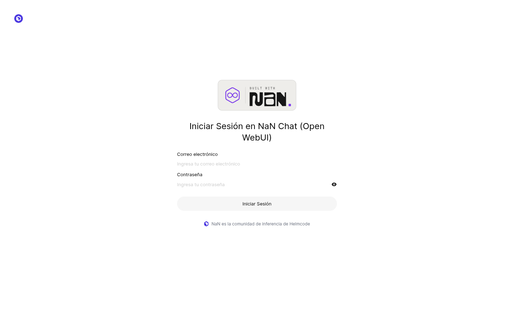
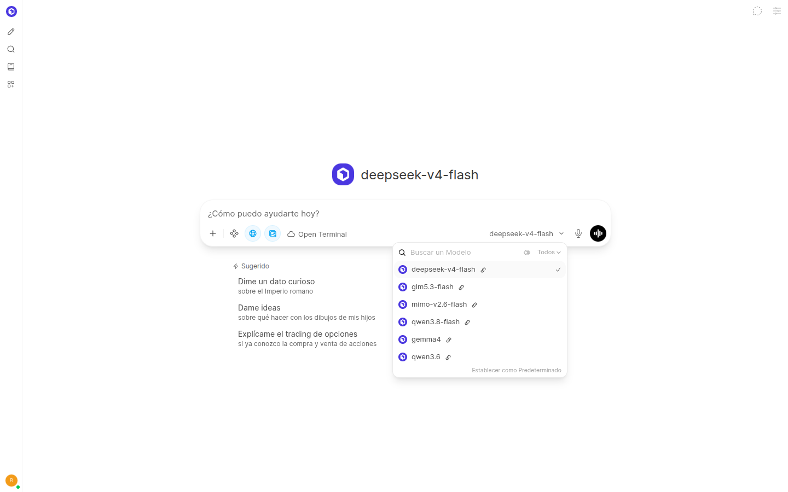
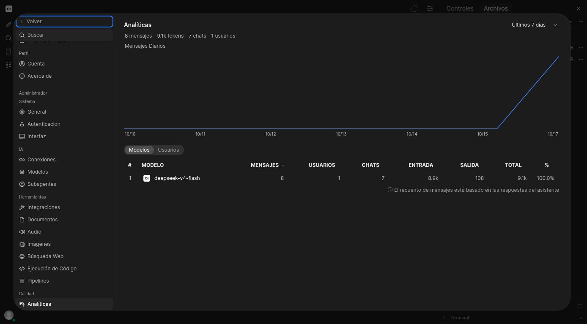
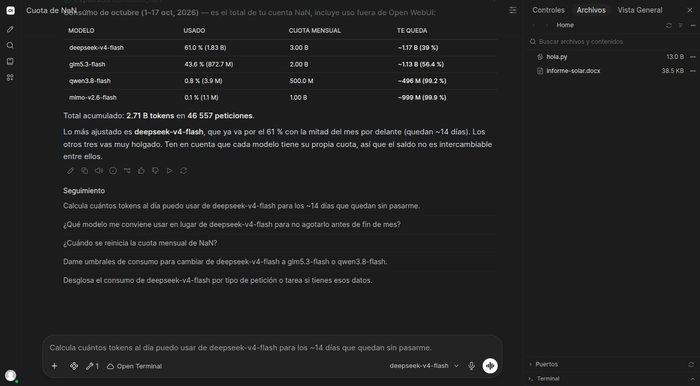
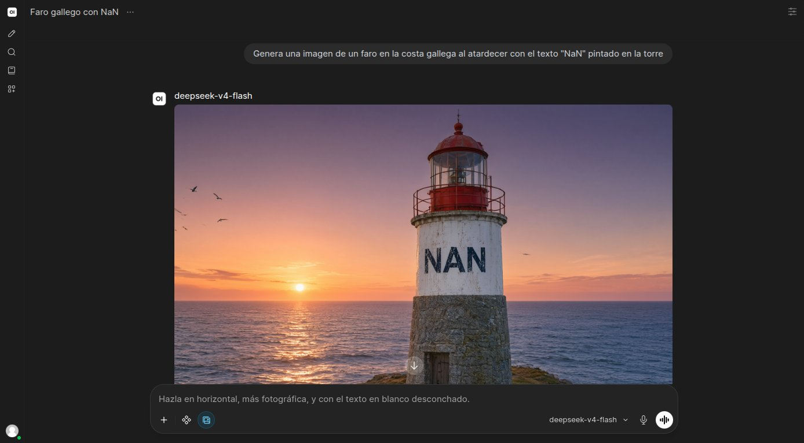
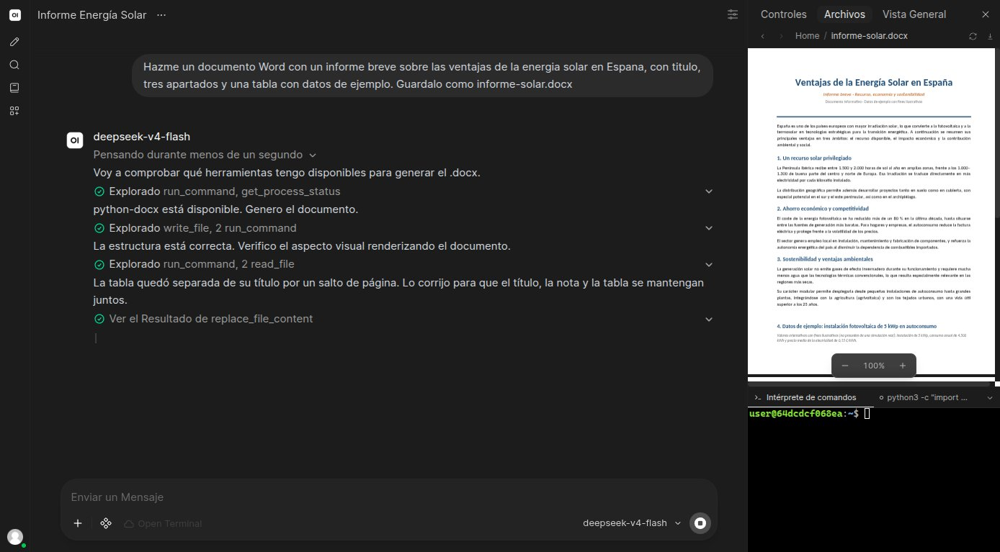

# NaN OpenWebUI

[](https://nan.builders/?ref=built-with-nan)

**Tu propio ChatGPT, con todos los modelos de NaN, corriendo en tu equipo y montado en 2 minutos.**

Version actual: **v1.0.1**. Cambios: [CHANGELOG.md](CHANGELOG.md).

**Documentación**

| Documento | Para qué |
| --- | --- |
| **[Manual de uso](MANUAL-DE-USO.md)** | Cómo usarlo todo: modelos, búsqueda, imágenes, documentos, voz, terminal y skills, descargas y consumo, con capturas |
| [Guía paso a paso](GUIA-PASO-A-PASO.md) | Instalarlo sin saber nada de Docker (Windows, Mac y Linux) |
| [Producción](PRODUCCION.md) | Servidor con dominio, HTTPS, Coolify y copias de seguridad |
| [Skills del terminal](skills/README.md) | Las 39 skills: origen, licencias y resultados de las pruebas |
| [CHANGELOG](CHANGELOG.md) | Qué cambia en cada versión y cómo actualizar |

Una interfaz web tipo ChatGPT ([Open WebUI](https://github.com/open-webui/open-webui))
ya conectada a la API de [NaN](https://nan.builders). Self-hosted, en Docker, con tu
propia API key. Tus chats y tus cuentas se quedan en tu máquina.

| Entrada | Dentro |
| --- | --- |
|  |  |

> ¿No has usado Docker nunca? Sigue la **[guia paso a paso, a prueba de errores](GUIA-PASO-A-PASO.md)** y no te equivocaras. Si te atascas, hasta puedes pedirle a un asistente de IA (como OpenCode con un modelo de NaN, p. ej. `deepseek-v4-flash`) que te lo monte: le abres dentro de la carpeta y le dices "levanta esta imagen Docker siguiendo el README".

---

## Por qué NaN OpenWebUI

- **Un único frontend para todo NaN.** Chat, visión, audio y embeddings de todos los
  modelos de NaN desde la misma interfaz, sin saltar de herramienta.
- **Tus datos, tu casa.** Las conversaciones, usuarios y ajustes viven en tu Docker, no
  en la nube de un tercero. La API key es tuya y solo sale hacia NaN.
- **Coste predecible.** Pagas tu inferencia en NaN y punto: la interfaz es gratuita y
  open source, sin capas de suscripción por encima.
- **Listo para equipos.** Levanta un servidor para tu equipo o comunidad: cada persona
  con su cuenta, tú administras quién entra (ver [Multiusuario](#multiusuario-varios-perfiles)).
- **Sin lock-in.** Es compatible con la API de OpenAI; si mañana cambias de proveedor,
  cambias una URL.

> En una frase: la experiencia ChatGPT, con el catálogo de NaN, bajo tu control.

---

## Qué incluye

- **Open WebUI** (la UI self-hosted de referencia) preconfigurada para NaN, publicada
  como imagen Docker lista para usar (`ghcr.io/686f6c61/nan-open-webui`, sin ningún
  secreto dentro).
- **Modelos de NaN** disponibles desde el selector:
  `deepseek-v4-flash` (por defecto), `glm5.3-flash`, `qwen3.8-flash`, `mimo-v2.6-flash`,
  `gemma4` y `qwen3.6` (chat / visión / razonamiento / herramientas / coding),
  `whisper` (audio -> texto), `kokoro` (texto -> voz), `qwen3-embedding` (embeddings),
  `rerank` (reordenado del RAG), `qwen-image-2.1` (generación de imágenes) y
  `flux-2-klein` (edición de imágenes).
  `glm5.3` solo con la membresía premium GLM 5.3 (ver [Modelos](#modelos-y-razonamiento)).
- **Capacidades**: chat con historial, **visión** (subir imágenes a los modelos
  multimodales), **búsqueda web** (incluye SearXNG autoalojado, sin API key: el modelo
  busca en internet y responde con fuentes), **voz** (lee las respuestas con `kokoro` de
  NaN y dicta con un whisper local), **intérprete de código** (el modelo escribe y ejecuta
  Python en el navegador), **RAG** sobre tus documentos (búsqueda híbrida con
  `qwen3-embedding` y reordenado con `rerank`),
  **generación de imágenes** con `qwen-image-2.1` y **edición** con `flux-2-klein`,
  **búsqueda web en 5 buscadores** a la vez, multiusuario con control de acceso, y
  persistencia.
- **Terminal con 39 skills** ([Open Terminal](#open-terminal)): el modelo crea Word,
  PowerPoint, Excel, PDF, webs, diagramas y vídeos en un contenedor aislado.
- **Despliegue en un comando** con Docker Compose, y copias de seguridad con
  `./backup.sh` y `./restore.sh`.
- **API key segura por diseño**: solo vive en tu `.env`, nunca en la imagen ni en el repo.

---

## Requisitos

- [Docker](https://docs.docker.com/get-docker/) y Docker Compose.
- Una **API key de NaN** -> https://nan.builders

---

## Puesta en marcha

```bash
# 0) Descarga el proyecto desde GitHub
git clone https://github.com/686f6c61/NaN-Open-WebUI.git
cd NaN-Open-WebUI

# 1) Crea tu .env (genera tambien los secretos locales)
./setup.sh

# 2) Edita .env y pon tu API key en NAN_API_KEY
nano .env

# 3) Arranca
docker compose up -d
```

Abre **http://localhost:3000**. La **primera cuenta que crees sera la de administrador**.

> Windows/Mac sin `./setup.sh`: copia `.env.example` a `.env`, pon tu `NAN_API_KEY` y
> genera `WEBUI_SECRET_KEY` y `SEARXNG_SECRET` con `openssl rand -hex 32`. Luego
> `docker compose up -d`.

---

## Usar solo la imagen, sin clonar

La imagen publicada en GHCR ya trae la preconfiguración de NaN (modelos, imágenes,
voz, RAG apuntando a `https://api.nan.builders/v1`), así que solo necesitas inyectar
tu key y los secretos en runtime:

```bash
NAN_API_KEY=sk-tu-key-de-nan
docker run -d --name nan-open-webui -p 127.0.0.1:3000:8080 \
  -e OPENAI_API_KEY=$NAN_API_KEY \
  -e RAG_OPENAI_API_KEY=$NAN_API_KEY \
  -e RAG_EXTERNAL_RERANKER_API_KEY=$NAN_API_KEY -e ENABLE_RAG_HYBRID_SEARCH=true \
  -e AUDIO_TTS_OPENAI_API_KEY=$NAN_API_KEY \
  -e IMAGES_OPENAI_API_KEY=$NAN_API_KEY -e IMAGES_EDIT_OPENAI_API_KEY=$NAN_API_KEY \
  -e WEBUI_SECRET_KEY=$(openssl rand -hex 32) \
  -e ENABLE_WEB_SEARCH=false \
  -v nan-open-webui-data:/app/backend/data \
  ghcr.io/686f6c61/nan-open-webui:v1.0.1
```

Imagen: `ghcr.io/686f6c61/nan-open-webui` (tags `vX.Y.Z` y `latest`, para `linux/amd64` y `linux/arm64`).
Usa siempre un tag de versión: `latest` apunta a la última release y, al cambiar,
puede traer migraciones de base de datos. Las imágenes de pruebas de `main` se
publican como `main` y `sha-<commit>`, nunca como `latest`.

> Cada servicio (embeddings, reranker, voz, imágenes) necesita la key en su propia
> variable: Open WebUI no reutiliza `OPENAI_API_KEY` para ellos.
>
> Nota: este modo de un solo contenedor **no incluye la búsqueda web** (que necesita el
> servicio SearXNG), por eso se desactiva. Para tener búsqueda web, usa el
> `docker compose up -d` de arriba.

---

## Multiusuario (varios perfiles)

Open WebUI es multiusuario con roles (admin / user / pending). El flujo recomendado
para un equipo o comunidad con este paquete:

1. **Tú creas la primera cuenta** (esa es la de administrador). Hazlo nada más
   arrancar: hasta que exista, cualquiera que llegue a la URL podría crearla.
2. **El registro viene cerrado** (`ENABLE_SIGNUP=false`): quien llegue a la URL solo
   ve el formulario de entrada. Las cuentas las das de alta tú en
   *Administración > Usuarios*, botón «+».
3. **Si prefieres que se registren solos**, pon `ENABLE_SIGNUP=true` en el `.env` y
   `docker compose up -d`. Con `DEFAULT_USER_ROLE=pending` (por defecto) cada registro
   queda en espera hasta que lo apruebes; con `user` entran directos.
4. **Modelos por grupo** (opcional): `BYPASS_MODEL_ACCESS_CONTROL=false` (por defecto)
   respeta el control de acceso; desde el panel puedes reservar modelos concretos a
   grupos concretos. Con `true`, todos ven todos los modelos siempre.

> Importante: con una única `NAN_API_KEY` compartida, el consumo de **todos** los
> usuarios (chat, imágenes, voz) sale de **tu** cuenta de NaN: cuota y facturación son
> agregadas y no se puede atribuir por persona. Para una comunidad grande valora que
> cada usuario ponga su propia key en *Ajustes > Conexiones* (el admin debe
> permitirlo), quedando la tuya solo como conexión por defecto.

Para exponerlo en internet con HTTPS, backups y actualizaciones controladas, sigue
**[PRODUCCION.md](PRODUCCION.md)**.

---

## Configuracion (`.env`)

| Variable | Obligatoria | Por defecto | Descripcion |
|---|---|---|---|
| `NAN_API_KEY` | **Si** | — | Tu API key de NaN |
| `WEBUI_SECRET_KEY` | **Si** | (se genera) | Firma las sesiones de la web; sin ella las sesiones caducan al recrear el contenedor |
| `SEARXNG_SECRET` | **Si** | (se genera) | Secreto local de SearXNG para la busqueda web |
| `OPENWEBUI_IMAGE` | No | `ghcr.io/686f6c61/nan-open-webui:v1.0.1` | Imagen y tag a usar; sube el tag para actualizar |
| `SEARXNG_IMAGE` | No | `searxng/searxng:2026.10.27-ef7bae9dd` | Imagen de SearXNG, fijada por tag de fecha |
| `WEBUI_BIND` | No | `127.0.0.1` | Interfaz donde se publica; `0.0.0.0` para red local |
| `WEBUI_PORT` | No | `3000` | Puerto local de la interfaz |
| `WEBUI_NAME` | No | `NaN Chat` | Nombre mostrado en la UI |
| `ENABLE_SIGNUP` | No | `false` | Registro abierto. Cerrado, solo el admin da de alta usuarios (la primera cuenta se crea igualmente) |
| `DEFAULT_USER_ROLE` | No | `pending` | Rol de los registros nuevos: `pending` (aprobación) o `user` |
| `BYPASS_MODEL_ACCESS_CONTROL` | No | `false` | `false` respeta el control de modelos por grupo |
| `ENABLE_PERSISTENT_CONFIG` | No | `true` | Ver [Configuracion persistente](#configuracion-persistente-importante) |
| `WEBUI_URL` | No | — | URL pública (producción con dominio) |
| `CORS_ALLOW_ORIGIN` | No | `*` | Orígenes CORS permitidos, `;` para separar |
| `OPENAI_API_BASE_URL` | No | `https://api.nan.builders/v1` | Endpoint OpenAI-compatible (Helmcode: `https://api.helmcode.com/v1`) |
| `OPENAI_API_CONFIGS` | No | (en `.env.example`) | Modelos de chat visibles en el selector |
| `DEFAULT_MODELS` | No | `deepseek-v4-flash` | Modelo elegido en los chats nuevos |
| `DEFAULT_MODEL_PARAMS` | No | `{}` (tool calling nativo) | Parámetros por defecto de todos los modelos (`function_calling`, `reasoning_effort`...). Ver [Modelos y razonamiento](#modelos-y-razonamiento) |
| `TASK_MODEL_EXTERNAL` | No | `deepseek-v4-flash` | Modelo de las tareas internas (títulos, etiquetas, sugerencias). Sin cuota: `gemma4` |
| `MODEL_ORDER_LIST` | No | deepseek, glm5.3, mimo, qwen3.8, gemma4, qwen3.6 | Orden de los modelos en el selector (JSON) |
| `ENABLE_CONTEXT_COMPACTION` | No | `true` | Resume el historial antiguo al pasar de 80.000 tokens (con `CONTEXT_COMPACTION_MODEL=deepseek-v4-flash`) |
| `ENABLE_TOOL_PERMISSIONS` | No | `true` | «Acceso completo» / «Solicitar aprobación» para las herramientas en el chat |
| `ENABLE_SUBAGENTS` | No | `true` | El modelo puede delegar en subagentes (`SUBAGENTS_*`: 20 a la vez, 30 iteraciones). Consumen llamadas extra a NaN |
| `PDF_EXTRACT_IMAGES` | No | `true` | OCR de las páginas de PDF que son solo imagen |
| `RAG_TEMPLATE` | No | la de NaN | Plantilla para responder con documentos; vacía = `branding/rag-template.txt` |
| `NAN_LOGO` | No | `true` | Logo de la comunidad NaN en favicon y barra lateral. **Con más de 50 usuarios, `false`** (licencia de Open WebUI) |
| `NAN_AVATAR` | No | `true` | Icono de NaN en lugar de la silueta gris cuando un usuario no tiene foto (o pulsa «Eliminar») |
| `TASK_MODEL_PARAMS` | No | `{"reasoning_effort":"none"}` | Parámetros de esas tareas; sin razonamiento son el doble de rápidas |
| `AUDIO_TTS_VOICE` | No | `ef_dora` | Voz de `kokoro`: `ef_dora` / `em_alex` (español), `af_heart`, `af_sky`... |
| `AUDIO_STT_ENGINE` | No | (vacío) | Dictado: vacío = whisper local (el audio no sale de tu equipo); `openai` = `whisper` large-v3 de NaN, más preciso con ruido, pero limitado a 10 peticiones/min por key |
| `DEFAULT_MODEL_METADATA` | No | capacidades con `usage` y herramientas recortadas | Capacidades y herramientas integradas por defecto; ver [Cuántos tokens gasta cada mensaje](#cuántos-tokens-gasta-cada-mensaje) |
| `ENABLE_TOOL_SEARCH` | No | `true` | Envía las herramientas largas solo por nombre (experimental) |
| `WEB_FETCH_MAX_CONTENT_LENGTH` | No | — (sin límite) | Máximo de caracteres de cada página web que lee el modelo |
| `ENABLE_RAG_HYBRID_SEARCH` | No | `true` | Búsqueda híbrida + reordenado con `rerank` de NaN |
| `RAG_EMBEDDING_BATCH_SIZE` | No | `32` | Textos por petición de embeddings (límite de NaN: 32 por lote, 60 peticiones/min) |
| `RAG_EMBEDDING_CONCURRENT_REQUESTS` | No | `2` | Peticiones de embeddings simultáneas |
| `ENABLE_IMAGE_GENERATION` | No | `true` | Activar generación de imágenes |
| `ENABLE_IMAGE_PROMPT_GENERATION` | No | `false` | Evita reescribir el prompt con el modelo de chat antes de llamar al modelo de imagen |
| `ENABLE_IMAGE_EDIT` | No | `true` | Activar edición / image-to-image |
| `IMAGE_GENERATION_MODEL` | No | `qwen-image-2.1` | Modelo para generar (~1 min, más fiel y con texto legible). Más rápido (~7 s): `flux-2-klein` |
| `IMAGE_EDIT_MODEL` | No | `flux-2-klein` | Modelo para editar imágenes (el único de NaN que edita) |
| `IMAGE_SIZE` | No | `1024x1024` | Tamaño por defecto, múltiplos de 16 (`qwen-image-2.1`: 512-1280 px; `flux-2-klein`: 256-1536 px) |
| `IMAGES_OPENAI_PARAMS` | No | `{"size":IMAGE_SIZE}` | JSON extra para generación. Fija el tamaño (el modelo a veces pide 1536 px y Qwen lo rechaza); si lo cambias, incluye `size`. Ej.: `{"size":"1024x1024","seed":42}` |

El registro viene cerrado: tras crear tu cuenta admin, das de alta a los demás desde
*Administración > Usuarios*. Para abrirlo, `ENABLE_SIGNUP=true` y `docker compose up -d`.

### Configuracion persistente (importante)

Open WebUI guarda su configuración en su base de datos interna: **lo que cambies en el
panel de administración manda sobre el `.env`** en los siguientes reinicios. Esto
afecta a cosas como la API key de las conexiones, los modelos visibles o el registro.

- Para cambiar la API key después del primer arranque: hazlo en el panel
  (*Admin > Settings > Connections*) y, para mantener el `.env` sincronizado,
  también en `NAN_API_KEY` (así un despliegue desde cero queda idéntico).
- Si prefieres que el `.env` sea siempre la fuente de verdad (útil en despliegues
  gestionados), pon `ENABLE_PERSISTENT_CONFIG=false`: los cambios hechos en el panel
  se perderán al reiniciar.

---

## Modelos y razonamiento

Catálogo de NaN (octubre de 2026, [nan.builders/docs/models](https://nan.builders/docs/models)).
Todos los modelos de chat admiten herramientas, imágenes de entrada y streaming:

| Modelo | Para qué | Contexto | Razonamiento (`reasoning_effort`) |
|---|---|---|---|
| `deepseek-v4-flash` | El recomendado para empezar | 1M | `none` lo apaga; `minimal`..`max` |
| `glm5.3-flash` | Multimodal, agentes | 1M | Siempre razona (`none` = `minimal`) |
| `qwen3.8-flash` | Visión, agentes | 1M | Activo por defecto; `none` lo apaga |
| `mimo-v2.6-flash` | Omnimodal (imagen y audio de entrada) | 1M | `none` lo apaga; `low`..`max` |
| `gemma4`, `qwen3.6` | Generación anterior, más pequeños | 262K | `none`/`minimal` lo apagan; `low` 2K, `medium` 8K, `high` 16K, `xhigh`/`max` 32K tokens |
| `glm5.3` | Coding y agentes de larga duración | 1M | Solo membresía premium GLM 5.3 |

Sin indicar nada, **todos los modelos razonan** antes de responder. Para ajustarlo:

- **Por chat**: *Controles del chat > Parámetros avanzados > Reasoning Effort*.
- **Por modelo**: en *Workspace > Models* puedes añadir un control "Thinking" con
  opciones Low/Medium/High que fijan `reasoning_effort` (Open WebUI 0.12).
- **Global**: `DEFAULT_MODEL_PARAMS={"reasoning_effort":"low"}`.

Valores válidos: `none`, `minimal`, `low`, `medium`, `high`, `xhigh`, `max`. Más
razonamiento significa más latencia, y esos tokens cuentan para `max_tokens`.

**Herramientas (`function_calling`)**: por defecto va en modo **nativo**: el modelo
decide por su cuenta cuándo buscar en internet, generar imágenes o consultar tus
documentos. Verificado con todos los modelos de chat de NaN. Si prefieres el modo
clásico, en el que Open WebUI ejecuta las integraciones activadas sin preguntar al
modelo, usa `DEFAULT_MODEL_PARAMS={"function_calling":"legacy"}`.

---

## Consumo

Con una key compartida, todo el consumo sale de la misma cuenta de NaN. Hay dos vistas
complementarias:

**Por usuario y por modelo (Open WebUI).** *Panel de administración > Analíticas*
muestra mensajes y tokens de entrada y salida por usuario y por modelo, con gráfica
diaria. Funciona porque los modelos traen activada la capacidad `usage`
(`DEFAULT_MODEL_METADATA`), que hace que Open WebUI pida a NaN el recuento de tokens; sin
ella el panel marca 0 tokens. Solo cuenta lo que pasa por Open WebUI.



**Cuota de la cuenta de NaN (herramienta `consumo_nan`).** Consulta `/v1/usage` y
compara lo gastado en el mes con la cuota mensual de cada modelo. Incluye todo el uso
de tu cuenta, también fuera de Open WebUI. Para instalarla:

1. *Espacio de trabajo > Herramientas > Importar desde enlace* y pega
   `https://github.com/686f6c61/NaN-Open-WebUI/blob/main/herramientas/consumo_nan.py`.
   O bien *Crear* y pega el contenido de [`herramientas/consumo_nan.py`](herramientas/consumo_nan.py).
2. En un chat: *Integraciones > Herramientas > Consumo de NaN* y pregunta, por ejemplo,
   "¿cuánto me queda de cuota de NaN este mes?".

Usa la misma key que la conexión, sin configurar nada. Al crearla queda privada: solo
la ven los administradores, porque enseña el consumo de toda la cuenta.



### Cuántos tokens gasta cada mensaje

En modo nativo, Open WebUI envía al modelo, en **cada** mensaje, el «manual» de todas
las herramientas que tiene disponibles (nombre, descripción y parámetros), para que
decida si usar alguna. Ese manual viaja aunque preguntes algo trivial y cuenta contra
tu cuota. Medido con un proxy, una pregunta de una línea:

| Configuración | Herramientas | Caracteres enviados |
|---|---|---|
| Open WebUI sin ajustar | 36 | 24.169 |
| Sin calendario, automatizaciones, tareas, notas, canales ni habilidades* | 20 | 12.724 (−47 %) |
| Solo Tool Search | 13 | 9.131 (−62 %) |
| **Las dos (lo que viene por defecto)** | 7 | **5.619 (−77 %)** |

- \* Medido también sin habilidades. Las habilidades se dejan activas: sin ellas el
  modelo no puede leer los ficheros de una skill, y sin ninguna seleccionada solo añaden
  `create_skill` (891 caracteres) a los administradores.
- Las categorías se apagan con `builtinTools` en `DEFAULT_MODEL_METADATA`. Para
  recuperar alguna (por ejemplo el calendario), cambia su valor a `true`.
- La **Tool Search** (*Búsqueda de herramientas* en *Admin > Settings > Interface*;
  `ENABLE_TOOL_SEARCH`, experimental en Open WebUI) envía las
  herramientas largas solo por nombre: el modelo busca la que necesita y luego la usa.
  Probado con búsqueda web y generación de imágenes. Añade un paso (1-3 s) cuando se
  usa una herramienta y a veces el modelo escribe esa frase previa en inglés.
- Si seleccionas Open Terminal se suman sus 14 herramientas (~10.000 caracteres).
- Al buscar en internet, cada página que el modelo abre entra entera en la
  conversación (se midió una de 79.585 caracteres). `WEB_FETCH_MAX_CONTENT_LENGTH` la
  recorta; por defecto no hay límite.
- Cada mensaje genera además 3 peticiones cortas al modelo de tareas (título,
  etiquetas y sugerencias de seguimiento), de unos 320 tokens cada una. Van a
  `deepseek-v4-flash` sin razonamiento (`TASK_MODEL_PARAMS`): medido, 1,5-2,3 s y 12
  tokens por título, frente a 3,5-6 s y unos 160 tokens razonando.

---

## Seguridad de la API key

- La key vive **solo en tu `.env` local**. No esta en la imagen Docker, ni en el
  `docker-compose.yml`, ni en el repositorio.
- La imagen publicada en GHCR es pública y **no contiene ningún secreto**: solo
  valores no sensibles (URLs de NaN, nombres de modelo, interruptores).
- Los secretos internos (`WEBUI_SECRET_KEY` y `SEARXNG_SECRET`) tambien se generan en
  `.env`; el repo no comparte valores reales entre instalaciones.
- El `.gitignore` y el `.dockerignore` excluyen `.env`: **no lo subes a git por error**
  ni entra en el contexto de build.
- Si arrancas sin key o sin secretos, Compose **se detiene con un aviso claro** en vez de arrancar mal.
- `./setup.sh` deja el `.env` con permisos `600` y avisa si pegas un platform token
  (`nan_pat_...`), que NaN no acepta para inferencia.
- Contenedores con `no-new-privileges`; SearXNG además sin capacidades de Linux salvo
  las imprescindibles. No se comparten chats con la comunidad de openwebui.com.
- Por defecto la web solo escucha en `127.0.0.1` (tu equipo). Con `WEBUI_BIND=0.0.0.0`
  la compartes en tu red local, bajo tu responsabilidad.
- **No compartas tu `.env`.** Para pasarle esto a otra persona, dale el proyecto **sin el
  `.env`** (o solo el `.env.example`); que cada uno ponga la suya.
- Si tu key se filtra, **revocala/rotala** en NaN, actualiza el `.env` **y** el panel de
  administración (ver [Configuracion persistente](#configuracion-persistente-importante)).

---

## Comandos utiles

```bash
docker compose up -d                            # arrancar / aplicar cambios del .env
docker compose logs -f                          # ver logs
docker compose down                             # parar (conserva los datos)
./backup.sh                                     # copia de seguridad en ./backups
./restore.sh backups/nan-AAAA-MM-DD_HHMMSS.tar.gz  # restaurar una copia
```

**Copias de seguridad.** `./backup.sh [directorio]` para la app unos segundos, copia el
volumen de datos (cuentas, chats, ajustes, documentos) a un `.tar.gz` con permisos
`600` y la vuelve a arrancar aunque algo falle. No copia los modelos que Open WebUI
descarga en su caché (whisper y embeddings, cientos de MB), porque se vuelven a
descargar solos. Con `KEEP_DAYS=14` borra además las copias de más de 14 días.
`./restore.sh` comprueba que el fichero es una copia de Open WebUI, pide confirmación
y, antes de tocar nada, guarda el estado actual en `backups/antes-de-restaurar/`.

> La imagen de Open WebUI va **fijada por tag** (`OPENWEBUI_IMAGE`): actualizar es una
> decision deliberada. Para subir de version: cambia el tag en el `.env` (p. ej. a
> `v1.0.1`), haz un [backup](PRODUCCION.md#backups) si tienes datos importantes, y
> `docker compose up -d`. SearXNG también va fijado (`SEARXNG_IMAGE`); no guarda datos,
> así que subirlo es seguro. Ojo: con la configuración persistente, los valores nuevos
> del `.env` no pisan lo ya guardado (ver [Configuracion persistente](#configuracion-persistente-importante)).
Los datos (cuentas, chats, ajustes) persisten en el volumen `nan-open-webui-data`.

### Generar imagenes en Open WebUI

En un chat, pulsa el boton **Integrations** junto a la caja de texto y activa **Image**
(icono de foto). Pide la imagen ("genera una imagen de...") y envia. El modelo de chat
redacta el prompt y llama a `qwen-image-2.1`, que tarda alrededor de un minuto. Para
editar una imagen, adjúntala y pide el cambio: se usa `flux-2-klein`.

Los modelos de imagen no aparecen en el selector superior porque son herramientas, no
modelos de chat. Que arriba siga seleccionado `deepseek-v4-flash` es normal: los modelos
de chat de NaN solo responden con texto, y es la integración **Image** la que genera.



#### Ejemplos

Imágenes generadas con esta configuración el 17/10/2026, sin retoques (reducidas a
768 px para el repositorio). En los tres primeros casos el prompt es lo que se escribió
en el chat: el modelo de chat lo amplía con detalles antes de pasarlo a `qwen-image-2.1`.

| Imagen | Prompt |
|---|---|
|  | `Genera una imagen de un faro en la costa gallega al atardecer con el texto "NaN" pintado en la torre`<br>Escribió "NAN" en mayúsculas. |
|  | `Genera una imagen horizontal y panoramica de un mercado de abastos en Valencia con un cartel que diga "Fruta fresca"`<br>Sale cuadrada: el tamaño va fijado a `IMAGE_SIZE`. |
|  | `Genera una imagen horizontal y panoramica de la Ciudad de las Artes de Valencia de noche con un cartel que diga "Hola NaN"` |

Comparativa de los dos modelos de imagen con el mismo prompt, enviado directamente a la
API (`/v1/images/generations`, 1024x1024):
`Cartel de una cafeteria con el texto "NaN Chat" en letras grandes, estilo ilustracion`

| `qwen-image-2.1` (68 s) | `flux-2-klein` (7 s) |
|---|---|
|  |  |

---

### Open Terminal

[Open Terminal](https://github.com/open-webui/open-terminal) da al modelo un terminal y
un navegador de ficheros dentro de su propio contenedor. Con él puede escribir y
ejecutar código o generar documentos, webs, diagramas y vídeos con las skills. **Viene
activado** (`COMPOSE_PROFILES=terminal` en el `.env`) y seleccionado en cada chat:
`./setup.sh` genera su clave (`OPEN_TERMINAL_API_KEY`) y la copia en la línea de
conexión (`TERMINAL_SERVER_CONNECTIONS`). Para apagarlo, comenta esas dos líneas del
`.env` y `docker compose up -d`.

> En una instalación que ya existía, la configuración persistente ignora
> `TERMINAL_SERVER_CONNECTIONS`: añade la conexión en *Admin > Settings > Integrations*
> con la URL `http://open-terminal:8000` y la clave `OPEN_TERMINAL_API_KEY`.

Ejemplo real: `Hazme un documento Word con un informe breve sobre las ventajas de la
energia solar en Espana, con titulo, tres apartados y una tabla con datos de ejemplo.
Guardalo como informe-solar.docx`. El modelo comprobó que tenía `python-docx`, generó el
fichero, lo renderizó para revisarlo y corrigió un salto de página que separaba la
tabla de su título:



**Skills precargadas.** El terminal viene seleccionado de serie en todos los modelos y
trae 39 skills listas, sin instalar ni activar nada: el modelo ve la lista y carga la que
necesita según el encargo.

| Para qué | Skills |
| --- | --- |
| Webs y diseño | `design-taste-frontend` (webs con dirección de arte), `theme-factory` (temas visuales), `canvas-design` (carteles) |
| Documentos | `minimax-docx` (Word), `minimax-pdf` (PDF), `pptx-generator` (PowerPoint), `minimax-xlsx` (Excel) |
| Presentaciones web | `frontend-slides` |
| Diagramas | `drawio` (organigramas y diagramas editables), `archify` (arquitectura y flujos) |
| Textos | `copywriting`, `copy-editing`, `humanizer`, `social`, `emails`, `content-strategy`, `meeting-notes` (actas) y `escritura-es` (español de España, propia) |
| Vídeo (HyperFrames) | `hyperframes` (punto de entrada) y 20 más para cada tipo de vídeo |

Licencias, versiones y resultados de las pruebas en [`skills/README.md`](skills/README.md).
Los encargos grandes son lentos: una landing llevó unos 70 minutos con qwen3.8-flash.
Para webs y vídeo rinde mejor deepseek-v4-flash (un vídeo de 15 s, completo, en 17
minutos).

**Descargar lo creado.** Panel Archivos → menú «⋯» del fichero → «Descargar». Una
carpeta se descarga entrando en ella y usando «Acciones» → «Descargar» (sale un ZIP). El
modelo ya entrega las webs y proyectos de varios ficheros empaquetados en un ZIP
(instrucciones en `terminal/AGENTS.md`).

**Dependencias.** La imagen ya trae lo necesario para documentos y datos: `python-docx`
(Word), `openpyxl` (Excel), `python-pptx` (PowerPoint), `pandas`, `matplotlib`,
`pandoc`, LibreOffice y Node. Si hace falta algo más, el modelo lo instala él mismo:

- `pip install ...` se instala en `/home/user/.local`, dentro del volumen
  `nan-open-terminal-data`: **se conserva** aunque se recree el contenedor.
- `sudo apt-get install ...` se instala en el contenedor y **se pierde** al recrearlo.
  Para paquetes fijos usa `OPEN_TERMINAL_PACKAGES`, `OPEN_TERMINAL_PIP_PACKAGES` u
  `OPEN_TERMINAL_NPM_PACKAGES` en el `.env` (separados por espacios), que se instalan en
  cada arranque.

**Seguridad.** Es una shell real, con `sudo` dentro de su contenedor y salida a
internet. Solo la usan los administradores salvo que des permiso a un grupo. No
publica puertos (solo Open WebUI llega a ella) y rechaza cualquier petición sin su
clave. No montes nunca el socket de Docker en este contenedor. La red de salida se
puede limitar con `OPEN_TERMINAL_ALLOWED_DOMAINS`, que requiere añadir la capacidad
`NET_ADMIN` al servicio.

---

## Solucion de problemas

- **No aparece ningun modelo** -> la `NAN_API_KEY` es incorrecta o vacia. Verificala:
  `curl https://api.nan.builders/v1/models -H "Authorization: Bearer TU_KEY"`
- **El puerto 3000 esta ocupado** -> cambia `WEBUI_PORT` en `.env` y `docker compose up -d`.
- **"Falta NAN_API_KEY"** al arrancar -> ejecuta `./setup.sh` y rellena el `.env`.
- **Una imagen da "no soporta imagenes"** -> todos los modelos de chat de NaN aceptan
  imágenes; si Open WebUI lo bloquea, activa *Vision* en *Admin > Settings > Models*.
- **La búsqueda web o un documento grande falla con `429 Too Many Requests` en
  `/v1/embeddings`** -> revisa que *Admin > Settings > Documents* tenga el tamaño de
  lote de embeddings en 32 (instalaciones anteriores a v1.0.0 lo tienen en 1).
- **`Rate limit exceeded ... max_parallel_requests`** -> NaN limita las peticiones
  simultáneas por modelo (7 en el plan base, 5 en `mimo-v2.6-flash`, `qwen3.6` y
  `gemma4`). Con muchos usuarios a la vez, reparte entre modelos.
- **Un modelo da `401 ... does not have access to the requested model`** -> tu
  suscripción no incluye ese modelo (p. ej. `glm5.3`): quítalo de `OPENAI_API_CONFIGS`.
- **Pides una foto y responde texto / no adjunta imagen** -> no esta activa la
  integracion **Image**: activala en **Integrations > Image**. Con la integración
  activa, el modelo decide generar la imagen; pídelo de forma explícita ("genera una
  imagen de...").
- **No puedo entrar desde otro equipo de mi red** -> por defecto la web solo escucha en
  `127.0.0.1`. Pon `WEBUI_BIND=0.0.0.0` en el `.env` para compartirla en tu red local.
- **Generar/editar imagenes falla** -> comprueba que tu cuenta de NaN tiene membresia
  `inference-tier`, que no has agotado la cuota de imágenes (100/mes, compartida entre
  `flux-2-klein` y `qwen-image-2.1`), que no pasas de 20 peticiones/min, y que `IMAGE_SIZE` usa valores soportados
  (256-1536 px, múltiplos de 16 y ratio 1:3-3:1).
- **La búsqueda web devuelve pocos resultados** -> SearXNG consulta buscadores públicos
  y alguno bloquea a ratos (Brave por exceso de peticiones, DuckDuckGo con CAPTCHA en
  su versión HTML). Comprueba cuáles responden con
  `docker exec nan-open-webui curl -s "http://searxng:8080/search?q=test&format=json" | jq '.unresponsive_engines'`
  y activa o desactiva buscadores en `searxng/settings.yml` (`docker compose restart searxng`).
- **`docker compose up` se queda esperando a SearXNG** -> el contenedor `nan-searxng`
  debe quedar `healthy`; revisa `docker compose logs searxng`.

---

## Notas

- Por defecto la web escucha en `127.0.0.1:WEBUI_PORT`, solo accesible desde tu equipo.
  Para tu red local: `WEBUI_BIND=0.0.0.0`. Para internet: proxy inverso con HTTPS, ver
  **[PRODUCCION.md](PRODUCCION.md)**.
- Compatible con cualquier endpoint estilo OpenAI: cambia `OPENAI_API_BASE_URL` para usar
  otro proveedor.

---

*Hecho para la comunidad de NaN. Open WebUI es un proyecto open source independiente;
NaN es el proveedor de inferencia. Cada usuario aporta su propia API key.*
